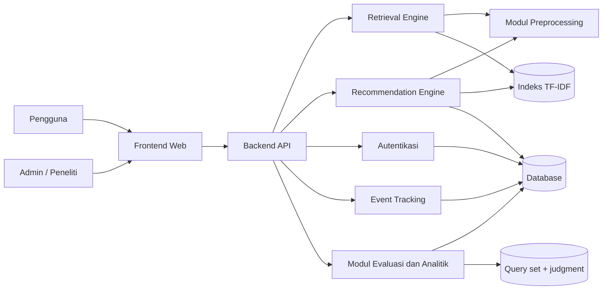
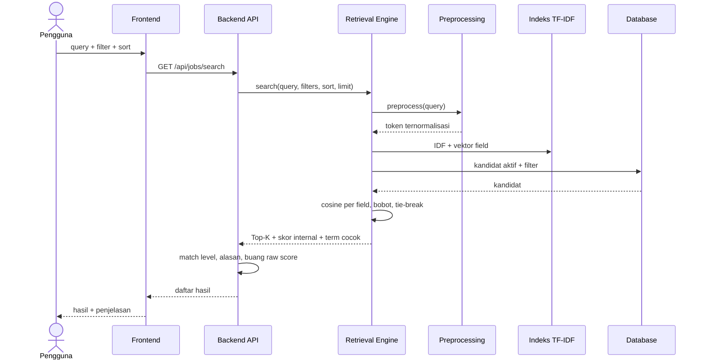
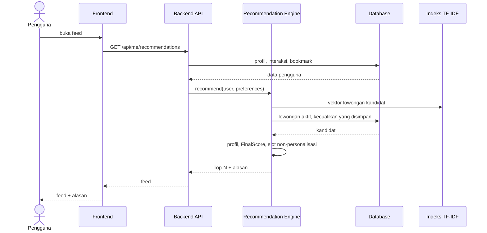
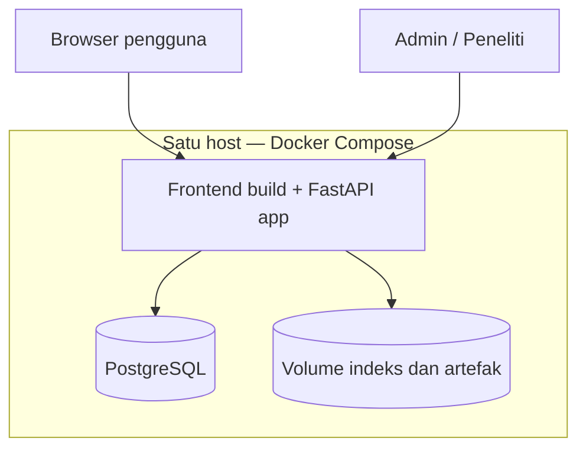

# System Design — KarirMatch

**Status:** Disetujui v1.0  
**Pemilik:** Deris Firmansyah  
**Sumber:** Grand Design Produk Inovatif KarirMatch Bagian 5, Bagian 7  
**Terakhir diperbarui:** 7 November 2026  
**Gaya arsitektur:** Modular monolith, satu deployable unit, indeks TF-IDF in-memory

---

## 1. Tujuan dan Ruang Lingkup

Dokumen ini menjelaskan bagaimana KarirMatch dibangun untuk memenuhi kebutuhan
fungsional di `01-prd.md` dan pertanyaan riset di
`research/research-and-evaluation.md`.

Ruang lingkup sistem:

- Web app untuk pencarian, filter, detail, bookmark, preferensi, feed rekomendasi, dan
  dashboard evaluasi.
- Mesin retrieval TF-IDF + Cosine Similarity.
- Mesin rekomendasi content-based berbasis profil vektor.
- Pencatatan event dan data evaluasi offline.
- Deployment satu host dengan Docker Compose.

Di luar ruang lingkup: microservices, message broker, antrean tugas, cache terdistribusi,
mesin pencari eksternal, embedding transformer/LLM sebagai inti, aplikasi seluler native,
dan sisi perekrut. Keputusan ini dicatat di `adr/ADR-0009-infrastruktur-ditunda.md`.

---

## 2. Prinsip Arsitektur

1. **Sederhana dan dapat dijelaskan** — satu aplikasi, satu database, satu indeks.
2. **Modul, bukan layanan** — batas modul jelas, tetapi berjalan dalam satu proses.
3. **Logika riset bebas framework** — retrieval, preprocessing, ranking, dan evaluasi
   berada di paket Python murni yang dapat dijalankan dari skrip tanpa server.
4. **Satu sumber data untuk dokumen dan query** — pipeline preprocessing yang sama
   dipakai retrieval dan rekomendasi.
5. **Transparan** — setiap skor dapat ditelusuri ke term, bobot, dan konfigurasi.
6. **Data evaluasi terpisah** — judgment dan query set tidak tercampur data pengguna.
7. **Tanpa optimasi prematur** — skala koleksi ribuan dokumen muat di memori.

---

## 3. Arsitektur Logis

### 3.1 Diagram komponen

Diagram ini merekonstruksi gambar “Arsitektur logis: 5 modul, 4 penyimpanan” pada
Grand Design Bagian 5.



**Lima modul:** Retrieval Engine, Recommendation Engine, Autentikasi, Event Tracking,
Modul Evaluasi dan Analitik.

**Empat aset bersama:** Modul Preprocessing, Indeks TF-IDF, Database, Query set +
judgment. Preprocessing adalah modul, bukan penyimpanan; tiga aset lainnya adalah
penyimpanan/indeks. Pemisahan ini mengikuti legenda gambar Grand Design.

### 3.2 Tanggung jawab komponen dan modul

Lima modul backend adalah Retrieval Engine, Recommendation Engine, Autentikasi, Event
Tracking, dan Modul Evaluasi. Frontend Web, Backend API, serta aset bersama dicantumkan
untuk kelengkapan batas tanggung jawab.

| Komponen/modul | Tanggung jawab | Batas / tidak melakukan |
|---|---|---|
| **Frontend Web** | Menampilkan pencarian, filter, detail, preferensi, bookmark, feed, dashboard; menyusun request; menampilkan tingkat kecocokan dan alasan | Tidak menghitung skor; tidak menyimpan keputusan bisnis |
| **Backend API** | Validasi input, orkestrasi modul, otorisasi, serialisasi respons, dokumentasi OpenAPI | Tidak berisi algoritma retrieval; tidak menyimpan state di memori proses |
| **Retrieval Engine** | Preprocessing query, vektorisasi, cosine per field, penggabungan skor, tie-break, pemilihan Top-K | Tidak mengubah data pengguna; tidak menghitung profil |
| **Recommendation Engine** | Membentuk profil vektor, menghitung ProfileScore/FinalScore, fallback cold start, slot non-personalisasi, alasan rekomendasi | Tidak melakukan collaborative filtering atau training model |
| **Autentikasi** | Registrasi, login, logout, sesi/token, hashing kata sandi, pembatasan percobaan login | Tidak menyimpan kata sandi mentah; tidak menangani otorisasi data pengguna di luar identitas |
| **Event Tracking** | Mencatat view, save, apply_click, rec_click, pencarian/zero-result; menandai `is_simulated` | Tidak menafsirkan klik sebagai relevansi mutlak |
| **Modul Evaluasi dan Analitik** | Menjalankan evaluasi offline, menghitung metrik, menyajikan ringkasan, mencatat konfigurasi dan versi | Tidak memakai data produk sebagai ground truth; hanya admin |
| **Modul Preprocessing** | Case folding, normalisasi, deteksi bahasa, tokenisasi, stopword, stemming, normalisasi singkatan, penggabungan field | Tidak memiliki state pengguna; konfigurasi eksperimen harus eksplisit |
| **Indeks TF-IDF** | Menyimpan vocabulary, IDF, matriks sparse per field, metadata konfigurasi dan dataset | Dibangun ulang dari sumber; bukan sumber kebenaran data |
| **Database** | Menyimpan user, preferensi, lowongan, skills, bookmark, riwayat, event, log rekomendasi, tabel evaluasi | Tidak menyimpan isi lamaran; tidak menyimpan kata sandi mentah |
| **Query set + judgment** | Menyimpan query evaluasi, split, grade relevansi, annotator, status anotasi | Tidak dipakai untuk personalisasi pengguna |

### 3.3 Batas proses

- Semua modul berjalan dalam satu proses Python/FastAPI.
- Retrieval dan Recommendation memanggil Modul Preprocessing secara in-process.
- Database diakses lewat lapisan repository/ORM; kueri berparameter.
- Indeks dimuat ke memori saat startup atau dibangun ulang lewat perintah eksplisit.
- Tidak ada panggilan jaringan antar-modul.

---

## 4. Alur Pencarian (Retrieval dan Ranking)

### 4.1 Langkah

1. Terima query, filter, sort, dan `limit`.
2. Validasi input dan normalisasi filter.
3. Preprocess query dengan pipeline yang sama seperti dokumen:
   case folding → normalisasi teks → deteksi bahasa → tokenisasi → stopword removal →
   stemming → normalisasi singkatan.
4. Bentuk vektor query memakai IDF dari koleksi dokumen (IDF tidak dihitung ulang dari
   query), lalu normalisasi L2.
5. Ambil kandidat lowongan aktif dari database dan terapkan filter wajib (lokasi,
   kategori, tipe, level).
6. Untuk setiap kandidat, hitung cosine per field: `title`, `skills`, `description`.
7. Gabungkan skor field dengan bobot (awal 0,4; 0,3; 0,3).
8. Urutkan: skor menurun → tanggal terbit terbaru → `job_id` menaik.
9. Ambil Top-K.
10. Hitung tingkat kecocokan relatif dan term yang cocok untuk penjelasan.
11. Kembalikan hasil tanpa skor mentah ke pengguna biasa.
12. Catat event pencarian/zero-result bila diaktifkan.

### 4.2 Sequence diagram



### 4.3 Formulasi TF-IDF

Mengikuti konvensi `TfidfVectorizer` scikit-learn dengan `sublinear_tf=True`,
`smooth_idf=True`, dan `norm="l2"`.

Notasi:

- `N` = jumlah dokumen.
- `df(t)` = jumlah dokumen yang memuat term `t`.
- `tf(t,d)` = frekuensi term `t` pada dokumen atau field `d`.

```text
tf'(t,d) = 1 + ln(tf(t,d))   jika tf(t,d) > 0
         = 0                 jika tf(t,d) = 0

idf(t) = ln((1 + N) / (1 + df(t))) + 1

w(t,d) = tf'(t,d) × idf(t)

v_d = w_d / ||w_d||₂
```

Vektor query dibentuk dengan rumus yang sama memakai IDF koleksi dokumen, lalu
dinormalisasi L2.

### 4.4 Skor query dan penggabungan field

```text
QueryScore(q,d) = Σ_{f∈F} w_f × cos(v_q, v_{d,f})

F = {title, skills, description}
Σ_{f∈F} w_f = 1
```

Bobot awal: `title = 0,4`, `skills = 0,3`, `description = 0,3`. Bobot ini adalah
hipotesis desain yang diuji lewat eksperimen, bukan hasil empiris.

Karena vektor sudah L2-normal:

```text
cos(v_q, v_d) = (v_q · v_d) / (||v_q|| × ||v_d||) = v_q · v_d
```

Skor berada pada rentang `[0,1]` untuk term non-negatif.

### 4.5 Urutan deterministik

1. Skor menurun.
2. Jika skor sama, `publication_date` terbaru lebih dulu.
3. Jika tanggal sama, `job_id` menaik.

Aturan ini wajib diuji (TC04) agar hasil dapat direproduksi.

### 4.6 Contoh perhitungan

Data sintetis dari Grand Design, `N = 4`, query `data analyst python`.

| Dokumen | Token setelah preprocessing |
|---|---|
| d1 | data analyst sql python |
| d2 | data engineer python python spark |
| d3 | web developer javascript react |
| d4 | data analyst excel report |

Nilai IDF:

| Term | df | IDF |
|---|---:|---:|
| data | 3 | 1,2231 |
| analyst | 2 | 1,5108 |
| python | 2 | 1,5108 |
| sql, engineer, spark, excel, report, web, developer, javascript, react | 1 | 1,9163 |

Hasil ranking:

| Peringkat | Dokumen | Cosine | Penjelasan |
|---:|---|---:|---|
| 1 | d1 | 0,7891 | Memuat ketiga term query |
| 2 | d2 | 0,5552 | Memuat `data` dan `python` (python dua kali), tanpa `analyst` |
| 3 | d4 | 0,4602 | Memuat `data` dan `analyst`, tanpa `python` |
| 4 | d3 | 0,0000 | Tidak ada term query |

Contoh ini menunjukkan keterbatasan TF-IDF: d2 mengungguli d4 karena `python` berulang
dan lebih langka dari `data`, walaupun d4 memuat frasa `data analyst` utuh. TF-IDF tidak
memperhatikan urutan kata.

### 4.7 Preprocessing

Satu modul untuk dokumen dan query, delapan langkah:

1. **Case folding** — huruf kecil.
2. **Normalisasi teks** — buang HTML/URL, rapikan spasi dan tanda baca, samakan variasi
   tulisan (`front-end`, `front end`, `frontend`).
3. **Deteksi bahasa per dokumen** (`id`, `en`, campuran) dengan heuristik rasio stopword;
   akurasi diperiksa pada sampel.
4. **Tokenisasi** — aturan khusus agar `c++`, `node.js`, dan `s1` tidak terpotong.
5. **Stopword removal** — daftar Indonesia dan Inggris terpisah, ditambah stopword domain
   (misalnya `lowongan`, `dibutuhkan`).
6. **Stemming per bahasa** — stemmer dipilih dan versinya dikunci; kualitas stemmer
   Indonesia dibandingkan oleh Mustikasari dkk. (2021).
7. **Normalisasi singkatan dan variasi istilah** lewat kamus manual (`swe` → `software
   engineer`, `s1` → `sarjana`, `fresh grad` → `fresh graduate`). Ini normalisasi
   leksikal, bukan pemahaman semantik.
8. **Penggabungan field berbobot** — tiap field divektorkan sendiri, lalu skor digabung.

Teks campuran memakai satu indeks bersama; stemming mengikuti bahasa dokumen dan token
ambigu pada dokumen campuran tidak di-stem. Langkah 5, 6, dan 7 dapat dinyalakan atau
dimatikan lewat berkas konfigurasi sebagai variabel eksperimen (RQ2). Tidak ada asumsi
bahwa stemming menaikkan hasil.

---

## 5. Alur Rekomendasi

### 5.1 Pembentukan profil

Untuk pengguna `u` dengan himpunan interaksi `I(u)`, tiap interaksi `i` terhadap dokumen
`d_i` memiliki bobot sinyal `s_i` dan umur `a_i` (hari):

```text
p_u = (Σ_{i∈I(u)} s_i × δ(a_i) × v_{d_i}) / ||Σ_{i∈I(u)} s_i × δ(a_i) × v_{d_i}||₂

δ(a) = 2^(-a/14)
```

`δ` adalah peluruhan waktu dengan half-life 14 hari (usulan).

| Interaksi | Bobot `s` | Alasan |
|---|---:|---|
| Klik detail | 1 | Sinyal paling lemah dan paling berisik |
| Simpan (bookmark) | 3 | Niat lebih eksplisit |
| Lamar (klik tombol lamar) | 5 | Niat paling kuat |
| Tidak tertarik | Tidak masuk MVP | Mengabaikan hasil tidak identik dengan tidak suka |

Pencegah dominasi satu interaksi:

- Vektor dokumen sudah L2-normal dan profil dinormalisasi lagi.
- Satu dokumen dihitung paling banyak sekali per jenis sinyal.
- Ada peluruhan waktu (half-life 14 hari).
- Interaksi aktif dibatasi, misalnya 50 terbaru.
- Sebagian slot Top-N (usulan 20%) dikhususkan untuk hasil non-personalisasi.

### 5.2 Skor akhir

```text
FinalScore(u,d) = α × QueryScore(u,d) + β × ProfileScore(u,d)

α + β = 1,  α,β ≥ 0

ProfileScore(u,d) = cos(p_u, v_d)
```

- Pengguna tanpa riwayat memakai `β = 0` (sama dengan pencarian biasa).
- Opsional: `β` naik bertahap, `β = β_max × min(1, n/n₀)`, dengan `n` jumlah interaksi
  dan `n₀` ambang yang dikonfigurasi.
- `α`, `β`, `β_max`, `n₀`, half-life, bobot sinyal, dan batas interaksi adalah parameter
  eksperimen; nilai final ditentukan lewat validation set.
- Rasio bobot 1:3:5 adalah hipotesis desain yang diuji lewat ablation, bukan hasil
  empiris.

**Keputusan terbuka:** pada feed rekomendasi tanpa query aktif, cara membentuk
`QueryScore` belum ditetapkan. Opsi yang dicatat:

1. `α = 0`, feed diurutkan dari `ProfileScore` + tie-break.
2. `QueryScore` dibentuk dari preferensi pengguna (kategori/lokasi sebagai term).
3. `QueryScore` dari query terakhir pengguna.

Sampai keputusan diambil, implementasi harus memakai satu opsi yang eksplisit dan
mencatatnya di konfigurasi.

### 5.3 Sequence diagram feed



### 5.4 Cold start dan feedback loop

- **Pengguna baru:** `β = 0`; feed non-personalisasi; tidak menampilkan alasan
  personalisasi palsu.
- **Lowongan baru:** langsung punya vektor TF-IDF dari teksnya; tidak perlu data
  interaksi.
- **Feedback loop:** 20% slot non-personalisasi; catat posisi tayang; pantau keragaman
  kategori; klik tidak ditafsirkan sebagai relevansi mutlak.
- **Position bias:** posisi tayang dicatat pada event; analisis dilakukan terpisah.

### 5.5 Alasan rekomendasi

Alasan harus dapat dilacak:

- “Mirip dengan lowongan yang Anda simpan” — berasal dari `ProfileScore` dan interaksi
  sumber.
- Istilah yang cocok — berasal dari term query yang berkontribusi pada `QueryScore`.
- Jangan memakai kalimat generik yang tidak dapat diverifikasi.

Detail format ada di `03-api-spec.md` dan `adr/ADR-0007-explainability-match-level.md`.

---

## 6. Tingkat Kecocokan dan Explainability

- UI menampilkan **Tinggi / Sedang / Rendah**, bukan skor mentah atau persentase.
- Batas dihitung relatif terhadap distribusi skor hasil query itu, bukan ambang absolut
  lintas query.
- Ikon info menjelaskan bahwa ini kemiripan teks, bukan peluang diterima.
- Skor mentah hanya tersedia di dashboard peneliti/admin.
- Istilah yang disorot harus term query yang benar-benar cocok.
- Kalibrasi batas Tinggi/Sedang/Rendah adalah keputusan terbuka; nilai awal harus
  dicatat di konfigurasi dan diuji pada usability test.

---

## 7. Arsitektur Data

### 7.1 Aset data

| Aset | Isi | Sifat |
|---|---|---|
| Database produk | User, preferensi, lowongan, skills, bookmark, riwayat, event, log rekomendasi | Sumber kebenaran transaksi |
| Indeks TF-IDF | Vocabulary, IDF, matriks sparse per field, metadata konfigurasi | Turunan; dapat dibangun ulang |
| Query set + judgment | Query evaluasi, split, grade 0–2, annotator | Terpisah dari data produk |
| Artefak eksperimen | Konfigurasi, seed, versi kode/pustaka, hasil metrik | Reproducibility |

### 7.2 Tabel utama

Ringkasan; detail ada di `data/database-design.md`.

- `users`
- `user_preferences`
- `job_categories`
- `jobs`
- `skills`
- `job_skills`
- `saved_jobs`
- `search_history`
- `interaction_events` (dengan `is_simulated`)
- `recommendation_logs` (opsional, berisi skor dan versi konfigurasi)
- `eval_queries`
- `relevance_judgments`

Tabel evaluasi dipisah dari tabel produk agar judgment tidak tercampur data pengguna.

### 7.3 Indeks TF-IDF

- Dibangun dari korpus yang sudah dibersihkan.
- Menyimpan matriks sparse per field dan IDF.
- Metadata wajib: hash dataset, konfigurasi preprocessing, versi pustaka, tanggal build.
- Dapat dibangun ulang dengan satu perintah.
- Dimuat ke memori; tidak ada layanan pencarian eksternal.
- Lokasi artefak: `artifacts/index/<config_hash>/` (usulan operasional).

---

## 8. Permukaan API

Ringkasan endpoint dari Grand Design Bagian 7; kontrak lengkap ada di `03-api-spec.md`.

| Metode | Path | Fungsi | Akses |
|---|---|---|---|
| POST | `/api/auth/register`, `/api/auth/login`, `/api/auth/logout` | Akun dan sesi | Publik / login |
| GET | `/api/jobs/search` | Pencarian Top-K dengan filter dan sort | Publik |
| GET | `/api/jobs/{job_id}` | Detail lowongan | Publik |
| GET, PUT | `/api/me/preferences` | Membaca dan mengubah preferensi | Login |
| GET, POST, DELETE | `/api/me/bookmarks` | Daftar, simpan, hapus bookmark (idempoten) | Login |
| POST | `/api/events` | Mencatat interaksi (`view`, `save`, `apply_click`, `rec_click`) | Login |
| GET | `/api/me/recommendations` | Feed Top-N; pengguna baru memakai `β = 0` | Login |
| DELETE | `/api/me/data` | Menghapus riwayat dan event pengguna | Login |
| GET, POST | `/api/admin/eval/summary`, `/api/admin/eval/run` | Ringkasan dan eksekusi evaluasi offline | Admin |

Catatan kontrak:

- Autentikasi: session cookie atau bearer token; **belum diputuskan**. Kontrak tidak
  mengubah body request.
- Pengguna biasa tidak menerima skor mentah.
- Admin wajib mendapat 403 bila bukan admin (TC12).
- Respons error memakai format konsisten yang diusulkan di `03-api-spec.md`.

---

## 9. Teknologi

| Komponen | Pilihan | Catatan |
|---|---|---|
| Frontend | React + Vite, CSS sederhana | Tanpa library state besar |
| Backend API | FastAPI | Validasi input dengan skema bawaan; dokumentasi OpenAPI otomatis |
| Database | PostgreSQL untuk deployment; SQLite untuk pengembangan dan pengujian | Skema sama |
| Search dan vectorization | scikit-learn (`TfidfVectorizer`, cosine), SciPy sparse | Verifikasi parameter terhadap dokumentasi versi yang dipakai |
| Preprocessing | Modul sendiri; stemmer Indonesia dan Inggris sebagai kandidat | Pustaka dipilih setelah diverifikasi; versi dikunci |
| Autentikasi | Sesi cookie atau token; kata sandi di-hash (bcrypt atau argon2) | Tidak menulis algoritma hash sendiri |
| Deployment | Docker Compose (aplikasi + database) pada satu host | Cek batas layanan gratis penyedia |
| Pengujian | pytest untuk backend; klien uji FastAPI; usability test 5–8 peserta | Cakupan modul inti minimal sekitar 70% |

**Fallback stack:** jika React belum dikuasai sebelum tahap 6, pindah ke Django monolit
tanpa mengubah modul retrieval dan rekomendasi. Seluruh logika penelitian berada di paket
Python murni yang tidak bergantung framework.

**Sengaja tidak dipakai:** microservices, message broker, antrean tugas, cache
terdistribusi, mesin pencari eksternal. Skala koleksi proyek (ribuan dokumen) muat di
memori.

---

## 10. Deployment

### 10.1 Topologi



- Satu host, satu aplikasi, satu database.
- Frontend build dapat disajikan sebagai static files oleh aplikasi atau server statis
  sederhana; keputusan akhir mengikuti kemudahan deployment.
- Indeks dan artefak eksperimen disimpan di volume agar dapat dibangun ulang.
- PostgreSQL untuk deployment; SQLite untuk pengembangan/pengujian dengan skema sama.
- Tidak ada load balancer, replica, atau cluster pada MVP.

### 10.2 Operasi build dan deploy

1. Siapkan environment dan rahasia (`.env`, tidak di-commit).
2. Jalankan migrasi database.
3. Bangun indeks dari dataset dengan konfigurasi yang dicatat.
4. Jalankan aplikasi dan database dengan Docker Compose.
5. Verifikasi health check sederhana dan halaman pencarian.
6. Catat versi kode, versi pustaka, hash dataset, dan hash konfigurasi.

### 10.3 Rebuild dan pemulihan

- Indeks dapat dibangun ulang dari data sumber dengan satu perintah.
- Database memiliki cadangan berkala; prosedur restore diuji minimal sekali.
- Jika indeks hilang, aplikasi harus memberi error yang jelas, bukan hasil kosong diam-diam.
- Jika database tidak tersedia, endpoint mengembalikan 503 dengan pesan yang aman.

---

## 11. Non-Functional Requirements

| ID | Kategori | Target | Cara memenuhi / mengukur |
|---|---|---|---|
| NFR-PERF-01 | Latensi pencarian | Median < 300 ms; p95 < 1.000 ms pada ≤5.000 dokumen | In-memory sparse matrix; benchmark 30+ pengulangan dengan warm-up; catat perangkat keras |
| NFR-PERF-02 | Waktu bangun indeks | Tercatat per ukuran koleksi; tanpa ambang ketat | Timer pada skrip build; catat 1k/5k/20k |
| NFR-REL-01 | Pemulihan indeks | Rebuild satu perintah | Skrip build deterministik; metadata konfigurasi |
| NFR-REL-02 | Cadangan database | Berkala | Backup otomatis/manual; uji restore |
| NFR-SEC-01 | Autentikasi dan data | Hash kata sandi; kueri berparameter; rate limit login; header keamanan; rahasia di environment | bcrypt/argon2; ORM/parameterized query; middleware keamanan |
| NFR-PRIV-01 | Data pengguna | Minimum; pseudonim pada log; hapus riwayat; tanpa isi lamaran | Desain tabel; endpoint delete; review log |
| NFR-A11Y-01 | Aksesibilitas | Keyboard, kontras, label formulir | Checklist UI; usability test |
| NFR-MAINT-01 | Maintainability | Modul retrieval/rekomendasi terpisah framework; konfigurasi di berkas; coverage minimal sekitar 70% | Struktur paket; pytest; review |
| NFR-DATA-01 | Kualitas data | Duplikat dibuang; field wajib; lowongan kedaluwarsa ditandai | Hash dedup; validasi; job `is_active` |
| NFR-EVAL-01 | Reproducibility | Seed, versi kode/pustaka, konfigurasi, hash dataset tercatat | Manifest eksperimen |
| NFR-OBS-01 | Observability | Log terstruktur untuk error dan event; dashboard evaluasi offline | Usulan: log JSON; tidak ada APM khusus di MVP |

---

## 12. Keamanan dan Privasi

### 12.1 Autentikasi dan otorisasi

- Registrasi, login, logout; kata sandi di-hash dengan bcrypt atau argon2.
- Tidak menulis algoritma hash sendiri.
- Sesi cookie atau token; jika cookie, gunakan `HttpOnly`, `Secure` (di deployment
  HTTPS), dan `SameSite` yang sesuai.
- Batas percobaan login dan pesan error yang tidak membocorkan keberadaan email.
- Otorisasi kepemilikan data: pengguna hanya dapat mengakses preferensi, bookmark, dan
  event miliknya.
- Endpoint admin/evaluasi dilindungi role admin; pengguna biasa 403.

### 12.2 Keamanan aplikasi

- Validasi input dengan Pydantic/FastAPI.
- Kueri database berparameter; hindari string interpolation.
- Header keamanan standar.
- Rahasia di environment variable, tidak di repository.
- CORS dibatasi ke origin frontend (usulan implementasi).
- Error tidak menampilkan stack trace atau detail internal.

### 12.3 Privasi

- Kumpulkan data minimum: email, preferensi, bookmark, event interaksi.
- Log analitik memakai pseudonim; jangan mencampur identitas langsung.
- Tidak menyimpan isi lamaran; hanya event `apply_click`.
- Tidak memakai atribut sensitif (usia, jenis kelamin, agama) sebagai sinyal.
- Fitur hapus riwayat dan event.
- Data simulasi diberi `is_simulated` dan tidak dihitung sebagai metrik produk.
- Data evaluasi terpisah dari data pengguna.

---

## 13. Reliability dan Operasi

- **Startup:** muat indeks; jika gagal, log error dan tampilkan status tidak siap.
- **Index rebuild:** perintah eksplisit; tidak otomatis saat request.
- **Database backup:** berkala; simpan di luar host.
- **Data stale:** lowongan kedaluwarsa ditandai `is_active = false` berdasarkan tanggal.
- **Duplikat:** deteksi hash `title + company + description` ternormalisasi; pertahankan
  yang terbaru.
- **Zero result:** bukan error; catat event.
- **Kegagalan eksternal:** tidak ada ketergantungan eksternal saat runtime; dataset
  diimpor secara offline.
- **Logging:** struktur log konsisten; jangan log kata sandi/token; sertakan request ID
  (usulan).

---

## 14. Strategi Pengujian

### 14.1 Jenis pengujian

| Jenis | Cakupan | Alat |
|---|---|---|
| Unit | IDF, cosine, normalisasi, tie-break, profil, filter, bobot | pytest |
| Integration | Endpoint API, autentikasi, bookmark idempotent, akses admin, event simulasi | pytest + FastAPI TestClient |
| Evaluation regression | Hasil contoh N=4; ranking deterministik; β=0 | pytest |
| Usability | 5–8 peserta; alur cari, simpan, feed, paham penjelasan | Protokol terpisah |
| Performance | 1k/5k/20k dokumen; 30+ pengulangan; warm-up dibuang | Skrip benchmark |

### 14.2 Test case wajib

| ID | Tujuan | Hasil yang diharapkan |
|---|---|---|
| TC01 | Nilai IDF sesuai rumus (korpus mini N = 4) | `idf(data) = 1,2231`; `idf(analyst) = idf(python) = 1,5108`; `idf(df=1) = 1,9163` (toleransi 1e-4) |
| TC02 | Peringkat TF-IDF + cosine, query “data analyst python” | Urutan d1, d2, d4, d3 dengan cosine 0,7891; 0,5552; 0,4602; 0,0000 |
| TC03 | Vektor ternormalisasi | Norma L2 vektor dokumen dan query = 1 (toleransi 1e-9) |
| TC04 | Deterministik saat skor sama | Dokumen lebih baru lebih dulu; jika tanggal sama, `job_id` menaik |
| TC05 | Query tanpa term yang dikenal | Hasil kosong, pesan “tidak ada hasil”, event zero-result tercatat |
| TC06 | Filter wajib | Tidak ada hasil dengan lokasi selain filter |
| TC07 | `β = 0` setara tanpa personalisasi | `FinalScore` sama dengan `QueryScore`; urutan identik |
| TC08 | Profil memengaruhi urutan | Dokumen bertema profil naik dibanding `β = 0` |
| TC09 | Tidak ada dominasi satu interaksi | Norma profil = 1; satu dokumen tidak membuat `ProfileScore` dokumen lain menjadi nol |
| TC10 | Lowongan tersimpan tidak diulang di feed | Lowongan yang disimpan tidak muncul di feed |
| TC11 | Bookmark idempoten | Satu baris tersimpan; respons kedua tidak galat |
| TC12 | Akses admin | Pengguna biasa mendapat 403 |
| TC13 | Event simulasi terpisah | Event `is_simulated = true` tidak dihitung pada metrik produk |

### 14.3 Definition of done pengujian

- Semua test case di atas lulus atau kegagalannya dijelaskan.
- Test data dan seed tersedia.
- Hasil benchmark disimpan bersama konfigurasi dan versi.
- Tidak ada test yang bergantung pada urutan eksekusi atau waktu nyata tanpa kontrol.

---

## 15. Batasan dan Evolusi

### 15.1 Batasan yang diterima

- TF-IDF tidak menangkap sinonim, semantik, dan urutan kata.
- Personalisasi berbasis aturan, bukan machine learning adaptif.
- Satu koleksi, 40–60 query, dan profil simulasi; hasil tidak digeneralisasi.
- Skala ribuan dokumen; bukan jutaan dokumen atau banyak tenant.
- Satu host; tidak ada SLA tinggi pada prototipe.

### 15.2 Pemicu evolusi

Pertimbangkan perubahan arsitektur hanya bila salah satu terjadi:

- Koleksi jauh melebihi 20.000 dokumen atau tidak lagi muat di memori.
- Kebutuhan multi-node, ketersediaan tinggi, atau banyak tenant.
- Kebutuhan pencarian semantik yang terbukti dari evaluasi, bukan asumsi.
- Kebutuhan online learning atau collaborative filtering.
- Kebutuhan sisi perekrut atau integrasi eksternal.

Perubahan tersebut harus melalui ADR baru; jangan menambah kompleksitas di MVP.

---

## 16. Keputusan Arsitektur Terkait

| ADR | Keputusan |
|---|---|
| [ADR-0001](adr/ADR-0001-monolit-modular.md) | Modular monolith |
| [ADR-0002](adr/ADR-0002-tfidf-cosine.md) | TF-IDF + Cosine Similarity sebagai inti retrieval |
| [ADR-0003](adr/ADR-0003-indeks-field-berbobot.md) | Indeks field berbobot dan preprocessing bersama |
| [ADR-0004](adr/ADR-0004-personalisasi-berbasis-aturan.md) | Personalisasi berbasis aturan |
| [ADR-0005](adr/ADR-0005-stack-fastapi-react.md) | FastAPI + React dengan fallback Django |
| [ADR-0006](adr/ADR-0006-penyimpanan-postgresql-sqlite.md) | PostgreSQL/SQLite dan indeks in-memory |
| [ADR-0007](adr/ADR-0007-explainability-match-level.md) | Tingkat kecocokan relatif, bukan skor mentah |
| [ADR-0008](adr/ADR-0008-evaluasi-offline-terpisah.md) | Data evaluasi terpisah dan protokol offline |
| [ADR-0009](adr/ADR-0009-infrastruktur-ditunda.md) | Infrastruktur terdistribusi ditunda |

---

## 17. Keputusan Terbuka

1. Cara membentuk `QueryScore` pada feed tanpa query.
2. Kalibrasi batas Tinggi/Sedang/Rendah.
3. Mekanisme autentikasi: session cookie atau bearer token.
4. Apakah `search`/`zero_result` masuk `interaction_events` atau `search_history`.
5. Lokasi penyimpanan indeks dan artefak (volume, object storage, atau filesystem).
6. Apakah tabel evaluasi berada di database yang sama dengan schema terpisah atau
   database terpisah.
7. Kebijakan pagination di luar Top-K.
8. Stack final: React + Vite atau Django monolit.

---

**Rujukan:** Grand Design Bagian 5, Bagian 7; `adr/`; `03-api-spec.md`; `data/database-design.md`;
`research/research-and-evaluation.md`.
