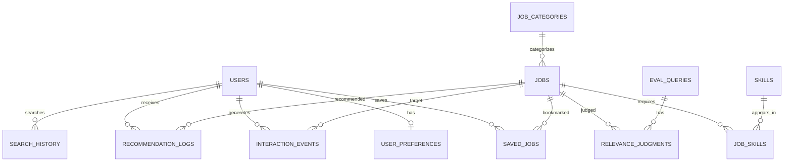

# Database Design — KarirMatch

**Status:** Disetujui v1.0  
**Pemilik:** Deris Firmansyah  
**Sumber:** Grand Design Produk Inovatif KarirMatch Bagian 4, Bagian 5, Bagian 7  
**Terakhir diperbarui:** 7 November 2026  
**Target:** PostgreSQL untuk deployment; SQLite untuk pengembangan/pengujian; skema sama

---

## 1. Prinsip Skema

1. **Data produk dan data evaluasi dipisah** — judgment tidak boleh tercampur data
   pengguna.
2. **Minimal data pribadi** — tidak menyimpan isi lamaran, CV, atau atribut sensitif.
3. **Portabel** — tipe data dan constraint yang dipakai harus didukung PostgreSQL dan
   SQLite.
4. **Deterministik** — ID dan timestamp konsisten; urutan tie-break memakai `job_id`.
5. **Dapat dihapus** — data pengguna memiliki jalur penghapusan yang jelas.
6. **Indeks TF-IDF bukan tabel** — indeks adalah artefak turunan yang dapat dibangun ulang.

---

## 2. Entity-Relationship Diagram

Catatan: `EVAL_RUNS` dan `RELEVANCE_JUDGMENTS` tidak memiliki relasi ke `USERS`; data
evaluasi tidak boleh dihubungkan ke identitas pengguna.

---

## 3. Tabel Produk

### 3.1 `users`

| Kolom | Tipe | Constraint | Keterangan |
|---|---|---|---|
| `id` | TEXT | PK | UUID/string |
| `email` | TEXT | UNIQUE, NOT NULL | Login |
| `password_hash` | TEXT | NOT NULL | bcrypt/argon2; tidak pernah plaintext |
| `role` | TEXT | NOT NULL, CHECK (`user`, `admin`) | Otorisasi admin |
| `created_at` | TIMESTAMP | NOT NULL | UTC |
| `updated_at` | TIMESTAMP | NOT NULL | UTC |

Catatan: jika memakai server-side session cookie, tambahkan tabel `sessions` atau
mekanisme session store; keputusan belum diambil.

### 3.2 `user_preferences`

| Kolom | Tipe | Constraint | Keterangan |
|---|---|---|---|
| `user_id` | TEXT | PK, FK → `users.id`, ON DELETE CASCADE | Satu baris per pengguna |
| `categories` | TEXT/JSON | NOT NULL, default `[]` | Daftar nama/slug kategori |
| `locations` | TEXT/JSON | NOT NULL, default `[]` | Daftar lokasi |
| `employment_types` | TEXT/JSON | NOT NULL, default `[]` | Daftar tipe |
| `experience_levels` | TEXT/JSON | NOT NULL, default `[]` | Daftar level |
| `updated_at` | TIMESTAMP | NOT NULL | UTC |

**Portabilitas:** simpan JSON sebagai `TEXT` di SQLite dan `JSONB` di PostgreSQL; validasi
struktur di aplikasi. Alternatif yang lebih ternormalisasi adalah tabel join per daftar,
tetapi belum diperlukan untuk MVP.

### 3.3 `job_categories`

| Kolom | Tipe | Constraint | Keterangan |
|---|---|---|---|
| `id` | TEXT | PK | UUID/string |
| `name` | TEXT | UNIQUE, NOT NULL | Nama kategori |
| `slug` | TEXT | UNIQUE | Untuk filter/URL |

### 3.4 `jobs`

| Kolom | Tipe | Constraint | Keterangan |
|---|---|---|---|
| `job_id` | TEXT | PK | ID lowongan |
| `external_id` | TEXT | NULL | ID dari sumber (usulan) |
| `title` | TEXT | NOT NULL | Teks retrieval |
| `company` | TEXT | NULL | Tampilan; bukan sinyal skor |
| `description` | TEXT | NOT NULL | Teks retrieval |
| `qualifications` | TEXT | NULL | Teks retrieval |
| `category_id` | TEXT | FK → `job_categories.id`, NULL | Filter |
| `location` | TEXT | NULL | Filter |
| `employment_type` | TEXT | NULL | Filter |
| `experience_level` | TEXT | NULL | Filter |
| `publication_date` | DATE | NULL | Tie-break dan kedaluwarsa |
| `source_url` | TEXT | NULL | Atribusi/sumber |
| `language` | TEXT | CHECK (`id`, `en`, `mixed`) | Kontrol stemming |
| `is_active` | BOOLEAN | NOT NULL, default `TRUE` | Lowongan kedaluwarsa |
| `dedup_hash` | TEXT | NOT NULL | Hash deduplikasi |
| `created_at` | TIMESTAMP | NOT NULL | UTC |
| `updated_at` | TIMESTAMP | NOT NULL | UTC |

**Aturan:** dokumen tanpa `title` dan `description` dibuang sebelum insert. `company`
tidak dimasukkan ke teks retrieval agar nama besar tidak mendominasi.

### 3.5 `skills`

| Kolom | Tipe | Constraint | Keterangan |
|---|---|---|---|
| `id` | TEXT | PK | UUID/string |
| `name` | TEXT | UNIQUE, NOT NULL | Nama skill |

### 3.6 `job_skills`

| Kolom | Tipe | Constraint | Keterangan |
|---|---|---|---|
| `job_id` | TEXT | PK, FK → `jobs.job_id`, ON DELETE CASCADE | |
| `skill_id` | TEXT | PK, FK → `skills.id`, ON DELETE CASCADE | |

Composite primary key (`job_id`, `skill_id`).

### 3.7 `saved_jobs`

| Kolom | Tipe | Constraint | Keterangan |
|---|---|---|---|
| `user_id` | TEXT | PK, FK → `users.id`, ON DELETE CASCADE | |
| `job_id` | TEXT | PK, FK → `jobs.job_id`, ON DELETE CASCADE | |
| `created_at` | TIMESTAMP | NOT NULL | Waktu simpan |

Composite primary key (`user_id`, `job_id`) menjamin idempotensi (TC11).

### 3.8 `search_history`

| Kolom | Tipe | Constraint | Keterangan |
|---|---|---|---|
| `id` | TEXT | PK | UUID/string |
| `user_id` | TEXT | FK → `users.id`, NULL, ON DELETE CASCADE | NULL untuk pencarian anonim (keputusan terbuka) |
| `session_id` | TEXT | NULL | Untuk sesi anonim (usulan) |
| `query` | TEXT | NOT NULL | Query mentah/ternormalisasi? Simpan mentah, proses saat evaluasi |
| `filters` | TEXT/JSON | NULL | Filter yang dipakai |
| `result_count` | INTEGER | NOT NULL | Jumlah hasil |
| `zero_result` | BOOLEAN | NOT NULL, default `FALSE` | Memudahkan analitik |
| `created_at` | TIMESTAMP | NOT NULL | UTC |

**Keputusan terbuka:** apakah riwayat pencarian anonim disimpan. Jika tidak, `user_id`
wajib dan `session_id` tidak dipakai.

### 3.9 `interaction_events`

| Kolom | Tipe | Constraint | Keterangan |
|---|---|---|---|
| `id` | TEXT | PK | UUID/string |
| `user_id` | TEXT | FK → `users.id`, NULL, ON DELETE CASCADE | NULL untuk event anonim (jika diizinkan) |
| `job_id` | TEXT | FK → `jobs.job_id`, NULL, ON DELETE SET NULL | NULL untuk event pencarian |
| `event_type` | TEXT | NOT NULL, CHECK | `view`, `save`, `apply_click`, `rec_click`, `search`, `zero_result` |
| `query` | TEXT | NULL | Untuk event pencarian |
| `position` | INTEGER | NULL | Posisi tayang untuk position bias |
| `is_simulated` | BOOLEAN | NOT NULL, default `FALSE` | Data simulasi (TC13) |
| `metadata` | TEXT/JSON | NULL | Data tambahan non-sensitif |
| `created_at` | TIMESTAMP | NOT NULL | UTC |

**Aturan:**

- Event personalisasi hanya memakai `is_simulated = FALSE` dan `user_id` tidak NULL.
- `apply_click` bukan pengiriman lamaran.
- Tidak menyimpan isi lamaran/CV.
- Event `save` idempoten per pengguna + lowongan + jenis sinyal.

### 3.10 `recommendation_logs` (opsional)

| Kolom | Tipe | Constraint | Keterangan |
|---|---|---|---|
| `id` | TEXT | PK | UUID/string |
| `user_id` | TEXT | FK → `users.id`, ON DELETE CASCADE | |
| `job_id` | TEXT | FK → `jobs.job_id`, ON DELETE CASCADE | |
| `rank` | INTEGER | NOT NULL | Posisi pada feed |
| `score` | REAL | NOT NULL | FinalScore |
| `query_score` | REAL | NULL | Komponen skor |
| `profile_score` | REAL | NULL | Komponen skor |
| `alpha` | REAL | NULL | Konfigurasi |
| `beta` | REAL | NULL | Konfigurasi |
| `config_version` | TEXT | NOT NULL | Reproducibility |
| `is_simulated` | BOOLEAN | NOT NULL, default `FALSE` | |
| `created_at` | TIMESTAMP | NOT NULL | UTC |

Tabel ini opsional; jika diaktifkan, jangan tampilkan skor mentah ke pengguna biasa.
Dapat dihapus oleh `DELETE /api/me/data`.

---

## 4. Tabel Evaluasi

Tabel evaluasi dipisah dari tabel produk. Tidak ada FK ke `users`.

### 4.1 `eval_queries`

| Kolom | Tipe | Constraint | Keterangan |
|---|---|---|---|
| `id` | TEXT | PK | UUID/string |
| `query_text` | TEXT | NOT NULL | Query evaluasi |
| `language` | TEXT | CHECK (`id`, `en`, `mixed`) | Hasil dilaporkan per bahasa |
| `filters` | TEXT/JSON | NULL | Filter yang melekat pada query |
| `split` | TEXT | NOT NULL, CHECK (`validation`, `test`) | Split evaluasi |
| `notes` | TEXT | NULL | Catatan niat query |
| `version` | TEXT | NOT NULL | Versi query set |
| `created_at` | TIMESTAMP | NOT NULL | UTC |

### 4.2 `relevance_judgments`

| Kolom | Tipe | Constraint | Keterangan |
|---|---|---|---|
| `id` | TEXT | PK | UUID/string |
| `query_id` | TEXT | FK → `eval_queries.id`, ON DELETE CASCADE | |
| `job_id` | TEXT | FK → `jobs.job_id`, ON DELETE CASCADE | |
| `grade` | SMALLINT | NOT NULL, CHECK (0–2) | 0 tidak relevan; 1 cukup; 2 sangat relevan |
| `annotator_id` | TEXT | NOT NULL | Pseudonim annotator |
| `is_double` | BOOLEAN | NOT NULL, default `FALSE` | Subset untuk Cohen’s κ |
| `judgment_version` | TEXT | NOT NULL | Versi pedoman |
| `created_at` | TIMESTAMP | NOT NULL | UTC |

Unique constraint: (`query_id`, `job_id`, `annotator_id`).

**Aturan:** annotator tidak melihat sistem mana yang menghasilkan dokumen dan tidak
melihat daftar seed profil. Pooling Top-15 dari semua sistem.

### 4.3 `eval_runs` (usulan operasional)

| Kolom | Tipe | Constraint | Keterangan |
|---|---|---|---|
| `id` | TEXT | PK | UUID/string |
| `experiment_id` | TEXT | NOT NULL | `E1`–`E5` |
| `config_hash` | TEXT | NOT NULL | Hash konfigurasi |
| `dataset_hash` | TEXT | NOT NULL | Hash dataset |
| `language` | TEXT | NULL | `id`, `en`, `mixed` |
| `split` | TEXT | NOT NULL | `validation`, `test` |
| `metrics` | TEXT/JSON | NOT NULL | P@K, MAP, NDCG, dll. |
| `latency` | TEXT/JSON | NULL | Median/p95 |
| `index_size_mb` | REAL | NULL | Ukuran indeks |
| `status` | TEXT | NOT NULL | `completed`, `failed` |
| `created_at` | TIMESTAMP | NOT NULL | UTC |

Tabel ini tidak ada di daftar Grand Design; ditambahkan agar dashboard evaluasi dapat
menyimpan hasil tanpa menghitung ulang. Jika tidak dipakai, hasil dapat disimpan sebagai
artefak JSON.

---

## 5. Constraint dan Indeks

### 5.1 Constraint penting

- `users.email` unik.
- `saved_jobs` composite PK → idempotensi.
- `relevance_judgments.grade` 0–2.
- `interaction_events.event_type` sesuai enum.
- `jobs.language` sesuai enum.
- FK dengan `ON DELETE CASCADE` untuk data milik pengguna.
- SQLite: aktifkan `PRAGMA foreign_keys = ON` per koneksi.

### 5.2 Indeks yang disarankan

| Tabel | Indeks | Alasan |
|---|---|---|
| `jobs` | (`is_active`, `publication_date` DESC) | Filter aktif + tie-break tanggal |
| `jobs` | (`location`) | Filter |
| `jobs` | (`employment_type`) | Filter |
| `jobs` | (`experience_level`) | Filter |
| `jobs` | (`category_id`) | Filter |
| `jobs` | (`dedup_hash`) | Deteksi duplikat |
| `saved_jobs` | (`user_id`, `created_at` DESC) | Daftar bookmark |
| `search_history` | (`user_id`, `created_at` DESC) | Riwayat |
| `interaction_events` | (`user_id`, `created_at` DESC) | Profil dan audit |
| `interaction_events` | (`job_id`, `event_type`) | Analitik |
| `interaction_events` | (`is_simulated`) | Pemisahan metrik |
| `recommendation_logs` | (`user_id`, `created_at` DESC) | Audit feed |
| `relevance_judgments` | (`query_id`, `job_id`, `annotator_id`) unik | Konsistensi |
| `eval_queries` | (`split`, `language`) | Evaluasi |

---

## 6. Retensi dan Penghapusan

### 6.1 `DELETE /api/me/data`

Urutan penghapusan yang disarankan:

1. `recommendation_logs` milik pengguna.
2. `interaction_events` milik pengguna.
3. `search_history` milik pengguna.
4. `saved_jobs` milik pengguna.
5. `user_preferences` milik pengguna.

Akun `users` tetap ada. Operasi harus atomik (transaksi) dan idempoten.

### 6.2 Data yang tidak dihapus

- `eval_queries` dan `relevance_judgments` — bukan data pengguna.
- Agregat anonim yang sudah tidak dapat diidentifikasi.
- Log keamanan yang diwajibkan kebijakan (jika ada); belum ditetapkan.

### 6.3 Retensi

Kebijakan retensi belum ditetapkan. Usulan untuk dibahas:

- Event interaksi: 12 bulan, lalu agregasi/anonymize.
- Riwayat pencarian: 12 bulan atau sampai pengguna menghapus.
- Data evaluasi: selama proyek dan untuk publikasi.
- Lowongan kedaluwarsa: tetap disimpan dengan `is_active = FALSE` untuk audit, atau
  diarsipkan.

---

## 7. Pemisahan Data Evaluasi

- Tabel evaluasi memakai prefix `eval_` dan tidak memiliki FK ke `users`.
- Endpoint admin hanya membaca tabel evaluasi dan data lowongan, bukan data pengguna.
- `relevance_judgments` disimpan terpisah dari `interaction_events`.
- `is_simulated` wajib pada event/rekomendasi simulasi.
- Metrik produk hanya dihitung dari event nyata (`is_simulated = FALSE`).
- Jangan memakai klik sebagai ground truth relevansi.

Opsi implementasi:

1. Schema terpisah (`eval.*`) di PostgreSQL; tabel prefix di SQLite.
2. Database terpisah untuk evaluasi.
3. Database sama dengan tabel prefix `eval_`.

**Keputusan terbuka:** pilih salah satu sebelum implementasi. Yang penting, akses aplikasi
produksi tidak boleh mencampur query evaluasi dengan query produk.

---

## 8. Portabilitas PostgreSQL dan SQLite

| Aspek | PostgreSQL | SQLite |
|---|---|---|
| UUID | `TEXT` atau `UUID` | `TEXT` |
| JSON | `JSONB` | `TEXT` dengan validasi aplikasi |
| Timestamp | `TIMESTAMP WITH TIME ZONE` | `TEXT`/`TIMESTAMP` UTC |
| Boolean | `BOOLEAN` | `INTEGER` 0/1 |
| FK cascade | Didukung | Perlu `PRAGMA foreign_keys = ON` |
| Check constraint | Didukung | Didukung |
| Concurrent write | Kuat | Terbatas; cukup untuk dev/test |

**Aturan:** gunakan lapisan ORM/migrasi (usulan: SQLAlchemy + Alembic) agar skema tidak
ditulis dua kali. Jangan memakai fitur PostgreSQL yang tidak punya padanan di SQLite
tanpa fallback.

---

## 9. Seed dan Data Uji

- Kategori dan skills awal dari korpus.
- Lowongan contoh untuk pengembangan.
- Query set mini untuk TC01/TC02 (N = 4, dokumen d1–d4).
- Profil simulasi untuk E3/E4.
- Semua data simulasi diberi `is_simulated = TRUE`.
- Seed database harus idempoten dan dapat dijalankan ulang.

---

## 10. Keamanan Data

- Kata sandi hanya `password_hash`.
- Tidak menyimpan token mentah jika memakai server-side session; jika token, simpan hash.
- Kueri berparameter.
- Akses database memakai user dengan hak minimum.
- Backup terenkripsi bila memuat data pribadi.
- Log tidak memuat kata sandi, token, isi lamaran, atau data sensitif.
- Data evaluasi tidak dihubungkan ke identitas pengguna.
- Hapus kontak pribadi dari teks lowongan bila tidak diperlukan (usulan).

---

## 11. Keputusan Terbuka

1. Mekanisme autentikasi dan kebutuhan tabel session.
2. Penyimpanan preferensi: JSON vs tabel join.
3. Apakah pencarian anonim disimpan (`session_id`).
4. Apakah `search`/`zero_result` masuk `interaction_events` atau hanya `search_history`.
5. Apakah `recommendation_logs` diaktifkan.
6. Lokasi tabel evaluasi: schema terpisah vs database terpisah.
7. Kebijakan retensi event dan riwayat.
8. Tipe ID: UUID vs string lain.
9. ORM/migrasi: SQLAlchemy + Alembic atau lain.
10. Apakah lowongan tidak aktif tetap dapat diakses via detail.

---

## 12. Traceability

| Bagian | Sumber Grand Design |
|---|---|
| Daftar tabel | Bagian 7 Database |
| Pemisahan evaluasi | Bagian 7 “Tabel evaluasi dipisah dari tabel produk” |
| Atribut lowongan | Bagian 4 Atribut dan alasan |
| `is_simulated` | Bagian 4, Bagian 6, TC13 |
| Bookmark idempoten | Bagian 6 TC11 |
| Akses admin | Bagian 6 TC12 |
| Profil dan rekomendasi | Bagian 5 Pembentukan profil dan skor akhir |
| Endpoint | Bagian 7 Endpoint utama |
