# Dataset dan Rancangan Data — KarirMatch

**Status:** Disetujui v1.0  
**Pemilik:** Deris Firmansyah  
**Sumber:** Grand Design Produk Inovatif KarirMatch Bagian 4  
**Terakhir diperbarui:** 7 November 2026  
**Catatan:** Belum ada dataset yang diunduh atau diverifikasi lisensinya.

---

## 1. Tujuan dan Prinsip

Dokumen ini menjelaskan korpus, atribut, label, kualitas data, dan batas etika/legalitas
yang dipakai untuk membangun serta mengevaluasi KarirMatch.

Prinsip:

1. **Lisensi sebelum data** — tidak ada unduhan sebelum lisensi dan ketentuan sumber
   diperiksa dan dicatat.
2. **Terpisah per bahasa** — hasil bahasa Indonesia dan Inggris dilaporkan terpisah,
   tidak digabung menjadi satu angka.
3. **Sintetis diberi label** — korpus sintetis dan interaksi simulasi tidak boleh
   disalahartikan sebagai data pasar atau perilaku pengguna nyata.
4. **Ground truth manusia** — relevance judgment dibuat manusia dengan pedoman, bukan
   klik sintetis.
5. **Minimal data pribadi** — hanya atribut yang dibutuhkan fitur.
6. **Dapat direproduksi** — sumber, versi, tanggal akses, hash, seed, dan konfigurasi
   dicatat.

---

## 2. Rencana Korpus

| Korpus | Ukuran (usulan) | Sumber | Fungsi | Batas klaim |
|---|---:|---|---|---|
| Utama Inggris | 3.000–5.000 dokumen | Satu kandidat dataset publik Kaggle, setelah lisensi diverifikasi | Evaluasi retrieval utama (RQ1, RQ2) | Tidak mewakili seluruh pasar kerja |
| Indonesia | 200–500 dokumen | Sintetis/tulisan sendiri dari template dan variasi istilah realistis | Evaluasi per bahasa dan campuran istilah | Bukan bukti kondisi pasar kerja Indonesia |
| Uji skala | 1.000, 5.000, 20.000 dokumen | Korpus sintetis berskala besar | Latensi dan ukuran indeks (RQ5) | Hanya untuk efisiensi, bukan relevansi dunia nyata |
| Query set | 40–60 query | Disusun peneliti, divalidasi lewat pilot anotasi | Evaluasi retrieval | Generalisasi terbatas pada query set ini |
| Profil simulasi | 6–10 profil persona, 3–8 lowongan seed per persona | Dibuat dari persona dan lowongan | Evaluasi personalisasi (RQ3, RQ4) | Interaksi simulasi, bukan perilaku nyata |

**Aturan pelaporan:** hasil per bahasa dipisah. Jika korpus Indonesia akhirnya memakai
sumber sah yang ditemukan, korpus sintetis diganti dan perubahan dicatat sebagai
keterbatasan/revisi.

---

## 3. Kandidat Sumber Data

Temuan pencarian awal; **harus dicek ulang langsung di halaman sumber** sebelum dipakai.

| Kandidat | Yang ditemukan | Catatan dan risiko |
|---|---|---|
| Kaggle “LinkedIn Job Postings (2023–2024)” (`arshkon`) | Sekitar 123.849 baris dan 31 kolom menurut ringkasan Baselight; kolom mencakup judul, deskripsi, `skills_desc`, `formatted_experience_level`, `work_type`, `listed_time` | Berbahasa Inggris. Data berasal dari LinkedIn; lisensi belum diverifikasi; ada risiko kepatuhan terhadap ketentuan layanan LinkedIn |
| Kaggle “LinkedIn Job Postings” (`rajatraj0502`) | Sekitar 15.886 baris; ringkasan Baselight menyebut lisensi ODbL dan mengingatkan bahwa data tunduk pada ketentuan LinkedIn | Lebih kecil sehingga lebih mudah dianotasi; lisensi tetap perlu dicek di sumber asli |
| Kaggle “Job Dataset” (`ravindrasinghrana`) | Sekitar 1,6 juta baris, dideskripsikan sintetis | Cocok untuk uji skala dan latensi (RQ5), tidak cocok sebagai dasar klaim relevansi dunia nyata |
| Korpus lowongan berbahasa Indonesia | Tidak ditemukan korpus publik lowongan berteks lengkap; hanya data agregat dan laporan World Bank tentang lowongan daring Indonesia | Bagian Indonesia harus disiapkan sendiri; jika sumber sah ditemukan, korpus sintetis diganti dan perubahan dicatat sebagai keterbatasan |

**Keputusan yang belum diambil:** dataset Inggris final, lisensi, dan apakah satu dataset
dipakai untuk seluruh eksperimen atau ada dataset pembanding. Keputusan harus dicatat
sebelum akuisisi.

---

## 4. Atribut dan Alasan

| Atribut | Peran | Alasan |
|---|---|---|
| `title` | Teks retrieval (bobot tinggi) | Sinyal terkuat untuk niat query |
| `skills` | Teks retrieval (bobot tinggi) | Mencerminkan kebutuhan kompetensi |
| `description`, `qualifications` | Teks retrieval | Isi lowongan; sublinear TF dan normalisasi L2 mengurangi bias panjang |
| `job_category`, `location`, `employment_type`, `experience_level` | Filter wajib | Bukan sinyal skor; dokumen yang tidak lolos dibuang |
| `company`, `source_url` | Tampilan | Nama perusahaan tidak masuk teks retrieval agar nama besar tidak mendominasi |
| `publication_date` | Tie-break dan kedaluwarsa | Hasil deterministik |
| `language` | Kontrol pipeline | Stemming mengikuti bahasa dokumen |

**Field turunan yang diusulkan (bukan bagian Grand Design):**

- `external_id` — ID dari sumber, untuk deduplikasi dan penelusuran.
- `dedup_hash` — hash `title + company + description` ternormalisasi.
- `is_active` — dihitung dari tanggal kedaluwarsa/kebijakan retensi.
- `ingested_at` — waktu impor.

---

## 5. Label dan Relevance Judgment

Ini **bukan supervised learning**. Tidak ada label latih untuk model; yang dibuat adalah
ground truth evaluasi.

### 5.1 Skala relevansi

| Grade | Arti | Contoh batas |
|---:|---|---|
| 0 | Tidak relevan | Topik/level tidak sesuai niat query |
| 1 | Cukup relevan | Topik sesuai, tetapi level/lokasi/kualifikasi tidak sepenuhnya cocok |
| 2 | Sangat relevan | Topik sesuai dan level/lokasi yang disebut query juga sesuai |

### 5.2 Protokol anotasi

1. Tulis pedoman anotasi: relevan jika judul, skills, atau kualifikasi sesuai niat query;
   sangat relevan jika juga sesuai level pengalaman dan lokasi yang disebut query;
   sertakan contoh batas kasus.
2. Pilot pada 5 query; bandingkan hasil dua annotator; perbaiki pedoman.
3. Minimal **2 annotator**; sebagian (usulan **25%**) dinilai ganda untuk Cohen’s κ.
4. Pooling **Top-15 dari semua sistem**; anotasi **buta** (annotator tidak melihat sistem
   mana yang menghasilkan dokumen dan tidak melihat daftar seed profil).
5. Selisih diselesaikan lewat diskusi; κ sebelum diskusi tetap dilaporkan.
6. Simpan semua judgment (CSV) beserta versi pedoman.
7. Jangan membuat klik sintetis dan menyajikannya sebagai perilaku pengguna nyata.

### 5.3 Beban anotasi

Kasus terburuk:

```text
40 query × 45 dokumen unik per query
= 1.800 pasangan untuk satu annotator
```

Angka ini belum termasuk judgment profil. Jika terlalu berat, kurangi jumlah query atau
kedalaman pool lebih awal dan catat sebagai keterbatasan. Annotator kedua dari luar
proyek belum ditentukan.

### 5.4 Kualitas anotasi

- Cohen’s κ pada subset ganda.
- Contoh batas kasus di pedoman.
- Konsistensi grade 0/1/2.
- Audit sampel oleh peneliti.
- Versi pedoman disimpan bersama judgment.

---

## 6. Kualitas dan Persiapan Data

| Masalah | Aturan penanganan |
|---|---|
| Field kosong | Dilewati pada penjumlahan skor; bobot field tersisa dinormalisasi ulang. Dokumen tanpa `title` dan `description` dibuang dan dicatat |
| Duplikat | Deteksi dengan hash `title`, `company`, dan `description` ternormalisasi; pertahankan yang terbaru |
| Inkonsistensi lokasi | Normalisasi lokasi; samakan variasi tulisan |
| Variasi istilah | Samakan `front-end`, `front end`, `frontend`; kamus singkatan dipakai sama pada dokumen dan query |
| Kedaluwarsa | Lowongan lama ditandai tidak aktif berdasarkan tanggal |
| Encoding kategorikal | Kategori, lokasi, dan tipe dipakai sebagai filter, bukan fitur model |
| Ketidakseimbangan | Komposisi bidang dan bahasa dilaporkan; hasil per bahasa dipisah |
| Data sintetis | Tidak dipakai sebagai bukti kondisi pasar kerja; interaksi simulasi diberi `is_simulated` dan tidak dihitung sebagai metrik produk |
| Konten sensitif/kontak | Usulan: buang email/telepon/URL pribadi dari teks sebelum indeks; jangan simpan data pribadi yang tidak perlu |
| Keyword stuffing | Uji dengan dokumen yang sengaja dijejali kata kunci; sublinear TF dan L2 normalization sebagai mitigasi |

### 6.1 Urutan pembersihan

```mermaid
flowchart LR
    A[Akuisisi] --> B[Verifikasi lisensi]
    B --> C[Normalisasi teks]
    C --> D[Deduplikasi]
    D --> E[Deteksi bahasa]
    E --> F[Validasi field wajib]
    F --> G[Sampling/stratifikasi]
    G --> H[Indeks TF-IDF]
    H --> I[Anotasi relevansi]
    I --> J[Split validation/test]
    J --> K[Evaluasi]
```



### 6.2 Pemeriksaan wajib sebelum indeks

- [ ] Semua dokumen punya `title` dan `description`.
- [ ] Duplikat sudah dibuang.
- [ ] Bahasa terdeteksi dan dicatat.
- [ ] Tanggal terbit valid dan zona waktu konsisten.
- [ ] Kategori/lokasi/tipe/level sudah dinormalisasi.
- [ ] Tidak ada HTML/URL yang mengganggu teks.
- [ ] Hash dataset dan jumlah dokumen dicatat.
- [ ] Lisensi dan atribusi tercatat.

---

## 7. Split, Tuning, dan Pencegahan Leakage

Karena tidak ada pelatihan model, yang dipisah adalah **query**:

| Bagian | Fungsi | Proporsi awal (usulan) |
|---|---|---|
| Validation | Memilih α, konfigurasi preprocessing, bobot field, half-life, batas interaksi | 30% atau 40% |
| Test | Dilaporkan sekali setelah konfigurasi dipilih | 70% atau 60% |

Aturan:

- Parameter yang dituning di validation: konfigurasi preprocessing, bobot field, α (grid
  1,0 sampai 0,5 dengan langkah 0,1), half-life, dan batas interaksi aktif.
- Dokumen seed profil dikeluarkan dari kandidat evaluasi.
- Judgment dibuat tanpa melihat daftar seed dan tanpa melihat sistem mana yang
  menghasilkan dokumen.
- Seed acak, versi kode, dan versi pustaka dicatat agar hasil dapat direproduksi.
- Jangan memakai test set untuk memilih konfigurasi atau menyesuaikan ambang.

**Keputusan terbuka:** split 30/70 atau 40/60; jumlah akhir query; apakah validation dan
test memakai query yang sama sekali berbeda atau stratified.

---

## 8. Data Sintetis dan Simulasi

### 8.1 Korpus Indonesia

- 200–500 dokumen (usulan).
- Dibuat dari template dan variasi istilah realistis: singkatan, campuran
  Indonesia–Inggris, variasi level, lokasi, dan tipe pekerjaan.
- Dinyatakan eksplisit sebagai sintetis/tulisan sendiri.
- Tidak dipakai sebagai bukti kondisi pasar kerja.
- Jika sumber sah ditemukan, korpus diganti dan perubahan dicatat.

### 8.2 Profil persona simulasi

- 6–10 profil persona.
- 3–8 lowongan seed per persona.
- Seed dipilih dari lowongan yang relevan dengan persona.
- Semua interaksi diberi `is_simulated = true`.
- Tidak dihitung sebagai metrik produk.
- Digunakan hanya untuk eksperimen E3/E4.

### 8.3 Aturan pelabelan simulasi

- Label “simulasi” muncul di tabel, dashboard, dan laporan.
- Jangan mencampur event simulasi dengan event pengguna nyata dalam agregat.
- Jangan mengklaim “pengguna menyukai” berdasarkan interaksi simulasi.
- Data sintetis skala besar hanya untuk latensi/ukuran indeks, bukan kualitas relevansi.

---

## 9. Etika dan Legalitas

Daftar ini adalah hal yang perlu diperiksa dan dikonsultasikan dengan dosen pembimbing
atau pihak kampus, **bukan nasihat hukum**.

- [ ] Baca lisensi dan ketentuan penggunaan di halaman sumber dataset sebelum mengunduh.
- [ ] Dataset hasil scraping platform dapat tunduk pada ketentuan platform asal.
- [ ] Jangan mengambil data sendiri dari situs lowongan tanpa memeriksa ketentuan layanan
      dan aturan akses otomatis situs tersebut.
- [ ] Catat sumber, lisensi, tanggal akses, dan versi dataset.
- [ ] Cantumkan atribusi sesuai lisensi di laporan dan antarmuka.
- [ ] Dataset sintetis Indonesia harus dinyatakan sintetis dan tidak dipakai sebagai bukti
      kondisi pasar kerja.
- [ ] Untuk uji kegunaan atau pilot dengan pengguna nyata, siapkan persetujuan tertulis
      dan tanyakan prosedur etik kampus.
- [ ] Periksa kewajiban berdasarkan peraturan pelindungan data pribadi di Indonesia.
- [ ] Rekomendasi tidak memakai atribut sensitif (usia, jenis kelamin, agama) sebagai
      sinyal.
- [ ] Fitur yang dipakai hanya teks lowongan, kategori, lokasi, tipe, dan level.
- [ ] Hapus kontak pribadi dari teks lowongan bila tidak diperlukan (usulan).

**Risiko utama:** dataset tidak representatif, lisensi tidak jelas, ground truth terbatas,
dan interaksi simulasi disalahartikan sebagai perilaku nyata. Mitigasi ada di
`delivery/risk-register.md`.

---

## 10. Dokumentasi dan Reproducibility

Setiap dataset dan hasil eksperimen harus memiliki manifest:

| Item | Contoh |
|---|---|
| Nama dataset | `linkedin_jobs_subset_2026` |
| Sumber | URL halaman dataset |
| Lisensi | Nama lisensi/ketentuan |
| Tanggal akses | `2026-11-07` |
| Versi | `v1` atau hash |
| Jumlah dokumen | 4.000 |
| Bahasa | `en`, `id`, `mixed` |
| Hash file | `sha256:...` |
| Konfigurasi preprocessing | `configs/prep_v1.yaml` |
| Seed | `42` |
| Versi kode | commit hash |
| Versi pustaka | scikit-learn, SciPy, stemmer |
| Perangkat keras | CPU/RAM untuk benchmark |

**Aturan:** hasil tanpa manifest tidak dianggap reproducible.

---

## 11. Mapping ke Database dan API

| Atribut dataset | Tabel/kolom | API |
|---|---|---|
| `title` | `jobs.title` | `JobSummary.title` |
| `skills` | `skills`, `job_skills` | `JobSummary.skills` |
| `description` | `jobs.description` | `JobDetail.description` |
| `qualifications` | `jobs.qualifications` | `JobDetail.qualifications` |
| `job_category` | `job_categories`, `jobs.category_id` | `JobSummary.category` |
| `location` | `jobs.location` | `JobSummary.location` |
| `employment_type` | `jobs.employment_type` | `JobSummary.employment_type` |
| `experience_level` | `jobs.experience_level` | `JobSummary.experience_level` |
| `company` | `jobs.company` | `JobSummary.company` |
| `source_url` | `jobs.source_url` | `JobDetail.source_url` |
| `publication_date` | `jobs.publication_date` | `JobSummary.publication_date` |
| `language` | `jobs.language` | `JobDetail.language` |
| `is_active` | `jobs.is_active` | `JobSummary.is_active` |

Detail skema: `data/database-design.md`.

---

## 12. Keputusan Terbuka

1. Dataset Inggris final dan lisensinya.
2. Apakah ada dataset pembanding untuk validasi eksternal.
3. Sumber korpus Indonesia yang sah, atau tetap sintetis.
4. Jumlah query final dan kedalaman pool.
5. Split validation/test: 30/70 atau 40/60.
6. Annotator kedua dan mekanisme rekrutmennya.
7. Alat anotasi: spreadsheet atau aplikasi khusus.
8. Ambang heuristik deteksi bahasa dan penanganan dokumen campuran.
9. Kebijakan retensi/kedaluwarsa lowongan.
10. Apakah kontak pribadi di teks lowongan dibuang sepenuhnya.

---

## 13. Traceability

| Bagian | Sumber Grand Design |
|---|---|
| Rencana korpus | Bagian 4 Sumber dan rancangan data |
| Kandidat dataset | Bagian 4 Kandidat sumber data |
| Atribut | Bagian 4 Atribut dan alasan |
| Label/judgment | Bagian 4 Label/target; Bagian 6 Pembuatan relevance judgment |
| Kualitas data | Bagian 4 Kualitas dan persiapan |
| Etika/legalitas | Bagian 4 Etika dan legalitas sumber data |
| Split/leakage | Bagian 5 Strategi pemodelan |
| Simulasi | Bagian 4 Batasan data sintetis; Bagian 6 |
| Manifest | Bagian 5, Bagian 7 |
